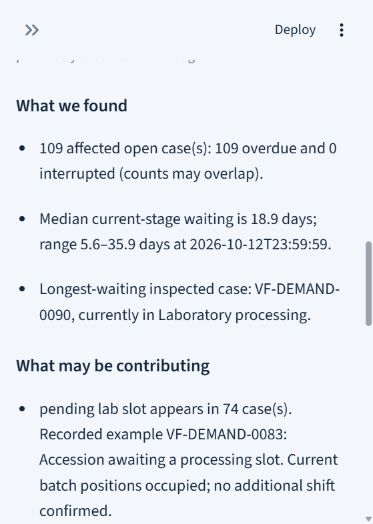

# ScaleFlow

### Business problem
A diagnostic workflow crosses several stages, making queues and delays difficult to investigate when process status and recorded histories are separated.

### What it does
A two-page process-monitoring application for the fictional VitaFlow Health blood-panel pathway. It shows active cases, overdue stages, completed turnaround, inspectable histories, evidence-derived delay findings, and editable local follow-ups. Excel imports are validated and previewed before analysis.

### Main workflow
Select a sample situation → review stages and turnaround → choose a detected delay → inspect case history and exception notes → edit the investigation summary → save a follow-up with an owner and deadline.

### Technologies
Python, Streamlit, Pandas, Altair, OpenPyXL, and SQLite. Prepared examples are computed from recorded evidence. Optional local Ollama code offers three read-only investigation tools in a bounded loop; it is not required for the default workflow.

## Run locally

Use Python 3.12 or newer. From this repository's root:

```bash
python -m venv .venv
# macOS / Linux
source .venv/bin/activate
# Windows PowerShell: use .\.venv\Scripts\Activate.ps1 instead
python -m pip install -r requirements.txt
python -m streamlit run app.py
```

Open the local URL printed by Streamlit. If PowerShell activation is restricted, invoke `.venv\Scripts\python.exe` directly for the pip and streamlit commands. No model or API key is required for the default demonstration. Dependencies include the existing test tooling; installing them does not run tests.

Use `python -m streamlit run app.py --server.port 8503` for the established local port. `launch.ps1` is an optional Windows convenience wrapper; it is not required on other operating systems.

### Demonstration data
The three fictional scenarios contain 222 Normal Operations, 244 Growing Demand, and 222 Operational Disruption cases over twelve weeks. JSON cases and stage events are authoritative; CSV copies and snapshots are retained with the manifest. `prepared/` holds labelled deterministic examples. [Data design](data/DATA_DESIGN.md) explains the fixtures. Sample records are not generated or overwritten during normal Streamlit reruns. Local follow-up databases are recreated as needed and excluded from Git.

### Application preview
Existing mobile capture of recorded delay findings, using fictional data:



### Limitations
Operational process analysis only: no clinical interpretation or medical priority decisions. Some cases have no recorded cause, and findings require review. Timestamps use one consistent Europe/Berlin operational wall clock; the sample interval has no daylight-saving change. No operational deployment or measured savings are claimed. The retained [local model status](verification/ollama_status.json) records a timeout, so successful live model-directed investigation is not claimed verified. Prepared examples are not executed AI output.

## Publication and hosting

Local databases, custom uploads, reviewer workspaces, secrets, caches, logs, review archives, and development outputs are excluded from Git. A fresh checkout starts from synthetic demonstration records and recreates its own SQLite state. Existing local state is retained on disk.

The Streamlit application needs a Python server and writable local storage; GitHub Pages cannot run it. Hosted SQLite files may be ephemeral, and this prototype has no production authentication or durable hosted storage configuration. Local Ollama requires a separately configured service and installed model; no model is bundled. Example environment variables are documentation only and are not automatically loaded from `.env.example`.

## Streamlit Community Cloud readiness

Deploy repository `shivamasthanasa-14/ScaleFlow`, branch `main`, entry point `app.py`, with Python 3.12. No secrets or system packages are required. Leave Use local Ollama for investigations unchecked and use the labelled deterministic prepared investigations.

Follow-ups now use temporary SQLite storage unique to each Streamlit browser session. Reruns and navigation retain that visitor's changes without exposing them to another session. Storage is temporary, not a durable record system. Existing local follow-ups are preserved; set `SCALEFLOW_WORKSPACE_MODE=local` before desktop launch to use the old local database. Do not use local mode publicly. The server bind is left to the deployment environment; locally add `--server.address 127.0.0.1` if loopback-only access is required. Live local AI remains optional and its successful execution is not claimed verified.
